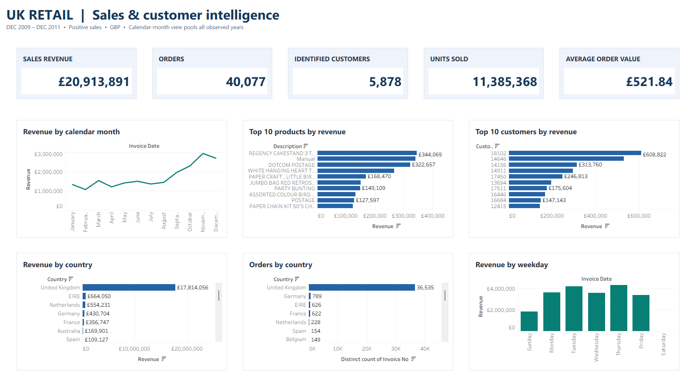
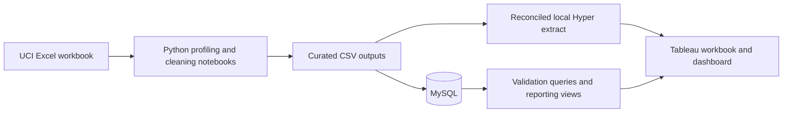

# UK Retail Sales & Customer Analytics

**Python · MySQL · Tableau | Historical retail performance from source workbook to executive dashboard**

This project investigates sales trends, customer concentration, product performance and cancellations using UCI Online Retail II. It connects profiling and cleaning notebooks to SQL analysis and an editable Tableau workbook.



*Genuine Tableau Desktop Public Edition presentation capture, 1600 × 900. The editable workbook uses a reconciled local Hyper extract; no Tableau Public upload is required.*

**Open offline:** [packaged editable Tableau workbook](tableau/workbook/uk_retail_sales_customer_analytics_dashboard.twbx) · [validation and native interaction evidence](docs/design/redesign_validation.json).

**Explore:** [executed EDA notebook](python/notebooks/03_exploratory_data_analysis.ipynb) · [SQL analyses](sql/03_analysis/) · [Tableau workbook](tableau/workbook/uk_retail_sales_customer_analytics_dashboard.twb) · [business summary](docs/architecture/project_summary.md)

## Business questions

- How do revenue and purchasing patterns vary over time?
- Which countries, products and customers account for the most sales?
- What do cancellation records and missing customer identifiers mean for interpretation?
- Where should a commercial team investigate seasonal capacity, availability and retention?

## Source-verified analytical results

| Metric | Fresh source reconciliation |
|---|---:|
| Raw transaction rows | 1,067,371 |
| Retained analytical rows | 1,029,609 |
| Reported sales revenue | £20,913,891.47 |
| Orders | 40,077 |
| Identified customers | 5,878 |
| Units sold | 11,385,368 |
| Average order value | £521.84 |
| Cancelled orders | 8,292 |
| Reported order cancellation rate | 17.14% |

The original XLSX was freshly reconciled with its recorded notebook cleaning rules, independent SQLite aggregates and Tableau Hyper SQL. All five displayed dashboard KPIs agree with those totals at their displayed precision. Revenue is shown to whole pounds on the dashboard and to pence above.

**Historical output discrepancy:** retained notebook outputs report 40,079 orders and £521.82 AOV. These do not reproduce from the supplied original workbook and recorded cleaning rules. The fresh result is 40,077 orders / £521.84, matching Tableau. The historical outputs are preserved; their exact cause is unverified. Revenue, sales and cancellation populations follow the [data dictionary](docs/data_dictionary/data_dictionary.md) and [SQL KPI definitions](sql/03_analysis/01_kpi_analysis.sql).

## Findings and potential decisions

- The documented analysis finds **November strongest in 2010 and the observed 2011 data**. Investigate stock availability and fulfilment capacity ahead of the year-end peak. Only 2010 is a complete calendar year; December 2011 ends on the 9th. The dashboard's month-name view pools years; use year-month analysis for chronological comparisons.
- The UK contributes approximately **£17.81M**, indicating geographic concentration. Compare international markets using comparable customer coverage and order definitions.
- Product rankings include operational labels such as **Manual** and **POSTAGE**. Separate merchandise from adjustments before using rankings for stock decisions.
- The documented **17.14% cancellation rate** motivates a review by product, customer and month; it is not evidence that a proposed intervention has improved performance.
- Missing customer identifiers limit customer-level segmentation and retention. Do not equate identified-customer coverage with the full transaction population.

## Workflow and implementation



| Location | Evidence |
|---|---|
| [python/notebooks/](python/notebooks/) | Profiling, cleaning and EDA notebooks with retained outputs |
| [python/scripts/](python/scripts/) | Cleaning and MySQL loading helpers |
| [sql/01_schema/](sql/01_schema/) | Database and table definitions |
| [sql/02_cleaning/](sql/02_cleaning/) | SQL validation |
| [sql/03_analysis/](sql/03_analysis/) | KPI, monthly, product, customer, country and time analysis |
| [sql/04_views/](sql/04_views/) | Reporting views |
| [tableau/](tableau/) | Editable TWB, local Hyper extract and portable TWBX |
| [docs/](docs/) | Requirements, data dictionary, architecture and business summary |

## Reproduce or review

Open the [packaged workbook](tableau/workbook/uk_retail_sales_customer_analytics_dashboard.twbx) in Tableau Desktop or Desktop Public Edition 2026.3+ for local inspection. It includes the genuine reconciled extract. The [TWB](tableau/workbook/uk_retail_sales_customer_analytics_dashboard.twb) also opens with the adjacent `tableau/extracts/sales_clean.hyper` in a complete clone.

To rebuild the data connection without database credentials, work from the repository root:

```bash
python -m pip install -r requirements-tableau.txt
python python/scripts/rebuild_tableau_extract.py --raw data/raw/online_retail_II.xlsx
```

Download the original workbook from [UCI Online Retail II](https://archive.ics.uci.edu/dataset/502/online+retail+ii). The script checks its SHA-256, reproduces the original notebook population, writes the ignored curated CSV and rebuilds the Hyper extract only when all six KPI checks pass. The bundled TWBX remains its validated snapshot until deliberately repackaged in Tableau. See [dataset attribution](DATA_LICENCE.md).

The original notebook → MySQL → SQL workflow is retained for study. Review notebook paths before running; the standalone legacy cleaning helper uses a different column convention. The MySQL loader appends rows, so avoid loading an already populated table twice. The redesigned workbook opens against its local extract and does not need the old database password or Mac clipboard source.

## Validation and limitations

- **Executed:** fresh XLSX reconciliation, independent SQLite and Hyper aggregates, native Tableau open, product mark selection, Top N filter change from 10 → 5 → 10, restored ranking, and genuine presentation capture. The publishable rebuild script was exercised separately against the original XLSX. See the [validation record](docs/design/redesign_validation.json).
- The preview is an exact pixel crop of a real Tableau window. Public Edition's image-export menu was disabled for the active dashboard; no mock or reconstructed dashboard image was used.
- The original AOV calculation, business worksheet shelves and filters are retained. Top ten product/customer views remain ranked by revenue. Country charts retain all countries and scroll.
- No global date/country dashboard filter or cross-filter/drillthrough action existed in the original workbook; none is claimed. Complete tooltip usability, every scroll position, phone layout and live MySQL refresh remain untested.
- Source transactions span December 2009–9 December 2011. The calendar-month chart pools years and partial months. These are historical findings.
- Sales retain anonymous transactions; distinct customer counts and customer rankings require a customer ID. Operational product labels such as Manual and POSTAGE remain visible and are not ordinary merchandise.

## Source and reuse

[UCI Online Retail II](https://archive.ics.uci.edu/dataset/502/online+retail+ii), Chen, D. (2012), provides the historical source data under CC BY 4.0. Project code and documentation use the [MIT License](LICENSE); source data retains its separate terms.
