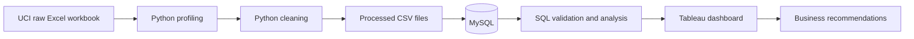
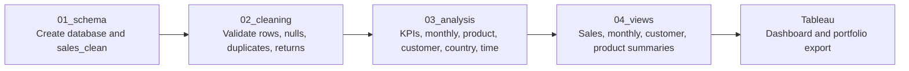

# UK Retail Sales & Customer Analytics

An end-to-end portfolio project analyzing more than one million transactions
from a UK-based online retailer. The project uses Python for controlled data
profiling and cleaning, MySQL for business analysis, and Tableau for executive
reporting.


## Project summary

| Area | Result |
|---|---:|
| Transactions analyzed | 1,029,609 |
| Total revenue | £20.91M |
| Orders | 40,079 |
| Customers | 5,878 |
| Units sold | 11.39M |
| Average order value | £521.82 |
| Cancelled orders | 8,292 |
| Cancellation rate | 17.14% |

## Business problem

Management needs a reliable view of sales performance, customer behavior,
product performance, geographic contribution, purchasing patterns, and
cancellations. This project turns the raw transaction workbook into validated
datasets, reproducible analysis, and an interactive decision-support dashboard.

The analysis answers:

- How much revenue did the business generate, and how did it change over time?
- Which products, customers, and countries contributed the most revenue?
- What are the strongest months, weekdays, and purchasing hours?
- How frequently do customers purchase?
- How significant are cancellations and returns?
- Which findings can support sales growth and customer retention?

## Key findings

- Revenue reached **£20.91M** across **40,079 orders**.
- November was the strongest month in both full calendar years, suggesting a
  pronounced year-end seasonal peak.
- The United Kingdom generated approximately **£17.81M**, making it the dominant
  market by a wide margin.
- `REGENCY CAKESTAND 3 TIER` was the highest-revenue named product in the
  product summary.
- The **17.14% cancellation rate** warrants monitoring by product, customer,
  and time period.
- Missing customer identifiers limit customer-level analysis for part of the
  transaction history, while aggregate sales reporting remains usable.

## Analytics workflow



## SQL pipeline



The SQL layer is organized in execution order. Validation queries reconcile the
loaded table before business-analysis queries and Tableau-facing views are run.

## Tools

- **Python:** pandas, NumPy, Jupyter
- **Database:** MySQL
- **Visualization:** Tableau
- **Supporting tools:** Excel, Git, GitHub

## Repository structure

```text
UK_Retail_Sales_Customer_Analytics/
├── data/
│   ├── raw/                  # Original source workbook (Git-ignored)
│   ├── processed/            # Cleaned and analytical outputs (Git-ignored)
│   └── reference/            # Supporting reference data
├── docs/
│   ├── architecture/
│   ├── business_requirements/
│   └── data_dictionary/
├── images/                   # Portfolio screenshots
├── python/
│   ├── notebooks/            # Profiling, cleaning, and EDA notebooks
│   └── scripts/              # Reusable cleaning and MySQL loading scripts
├── sql/
│   ├── 01_schema/
│   ├── 02_cleaning/
│   ├── 03_analysis/
│   └── 04_views/
├── tableau/
│   ├── workbook/             # Tableau workbook
│   └── exports/              # Dashboard exports
├── .env.example
├── requirements.txt
└── README.md
```

## Data source

The project uses the [UCI Online Retail II dataset](https://archive.ics.uci.edu/dataset/502/online+retail+ii),
which contains 1,067,371 transaction records from a UK-based non-store retailer
between December 2009 and December 2011.

The raw workbook is deliberately excluded from Git to keep the repository small
and preserve a clear raw-data boundary. Download `online_retail_II.xlsx` from UCI
and place it in `data/raw/` to reproduce the project.

## Methodology

1. Profiled both workbook sheets without altering the source.
2. Combined the yearly sheets and retained source-sheet lineage.
3. Inspected missing values, duplicates, cancellations, returns, descriptions,
   quantities, and prices.
4. Created separate cleaned sales, customer sales, cancellation, and MySQL-ready
   datasets.
5. Reconciled Python KPIs and generated reusable analytical CSV outputs.
6. Used MySQL queries for validation and business analysis.
7. Built a Tableau dashboard covering KPIs, trends, products, customers,
   geography, time patterns, and cancellations.

Detailed assumptions and initial quality findings are documented in the
[data dictionary](docs/data_dictionary/data_dictionary.md). A concise executive
interpretation is available in the [project summary and business insights](docs/project_summary.md).

## Reproduce the analysis

```bash
python3 -m venv .venv
source .venv/bin/activate
pip install -r requirements.txt
```

Then:

1. Download the UCI workbook to `data/raw/online_retail_II.xlsx`.
2. Run the notebooks in order:
   - `python/notebooks/01_data_profiling.ipynb`
   - `python/notebooks/02_data_cleaning.ipynb`
   - `python/notebooks/03_exploratory_data_analysis.ipynb`
3. Copy `.env.example` to `.env` and configure the local MySQL connection.
4. Run the SQL files in numeric folder order.
5. Open `tableau/workbook/uk_retail_sales_customer_analytics_dashboard.twb`
   and update the data connection if required.

Do not commit `.env`, passwords, raw data, processed data, or Tableau extracts.

## Dashboard

The Tableau workbook is available in `tableau/workbook/`, and the portfolio
image is available in `tableau/exports/` and `images/`. If the dashboard is
published to Tableau Public, add its public URL here.

## Limitations

- Customer IDs are missing for a meaningful portion of the raw data.
- Cancellation codes and negative quantities require careful interpretation.
- The dataset ends in December 2011, so findings demonstrate analytical method
  rather than current retail conditions.
- Several non-product descriptions, such as manual adjustments and postage,
  appear in transaction-level product rankings and should be separated for
  merchandising-specific analysis.

## License and attribution

Project code and documentation are released under the [MIT License](LICENSE).
The dataset is provided by the UCI Machine Learning Repository and is licensed
separately under CC BY 4.0. Cite: Chen, D. (2012), *Online Retail II*.
