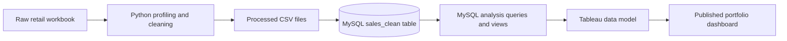

# Architecture

## Layers

- **Raw:** Immutable source files, excluded from version control.
- **Processed:** Reproducible cleaned extracts.
- **Warehouse:** Typed transaction tables in MySQL.
- **Analytics:** Stable views that define reporting logic.
- **Presentation:** Tableau worksheets, calculated fields, and dashboards.
