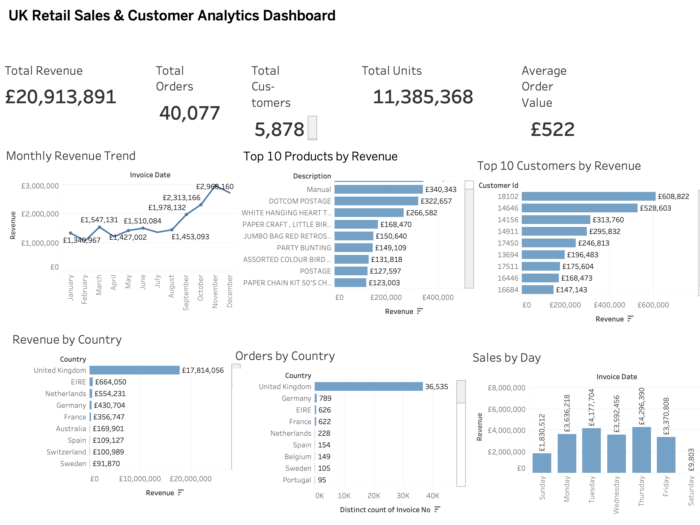

# Tableau dashboard

This folder contains the editable Tableau workbook and genuine dashboard export for the UK Retail Sales & Customer Analytics portfolio project.

[Open the workbook](workbook/uk_retail_sales_customer_analytics_dashboard.twb) · [Read the project and metric caveats](../README.md)

The saved image shows 40,077 orders; the retained Python notebook records 40,079. A fresh source-to-Tableau reconciliation remains necessary. This review preserved the original workbook and image.

## Structure

- `workbook/` — Tableau `.twb` or `.twbx` workbook files.
- `exports/` — exported dashboard images or PDFs for the portfolio.

## Data connection

Use either:

1. The MySQL `uk_retail_analytics` database and its reporting views; or
2. The curated CSV files in `data/processed/analysis_outputs/`.

The MySQL connection is preferred for demonstrating SQL and database skills.

## Dashboard analysis areas

- KPI summary
- Monthly revenue trend
- Top products by revenue
- Top customers by revenue
- Country-wise sales
- Revenue by weekday and hour
- Customer purchase frequency
- Cancellation and return analysis

## Review sequence

1. Executive KPI header
2. Revenue trend and time filters
3. Product and customer performance
4. Geographic performance
5. Cancellation insights and recommendations

Tableau Public content is publicly accessible. This project uses a public UCI
dataset and must not include passwords, connection credentials, or private data.

The repository includes a TWB connection definition, not a packaged extract. Update its source connection before refreshing; viewing the PNG requires no Tableau account. No public interactive Tableau URL is supplied.
